



 

## // THREE IDENTITIES

<table>
<tr>
<td width="33%" valign="top">

**`01` THE ENGINEER** 
Designs and builds intelligent software: autonomous agents, backend services and the data layer underneath them. Python first, with security and clean architecture as defaults.

</td>
<td width="33%" valign="top">

**`02` THE ENTREPRENEUR** 
Starts from a real business problem (lead generation, operations, tooling) and builds the product around it, with a growing eye on revenue and the customer.

</td>
<td width="33%" valign="top">

**`03` THE LEADER** 
Aspiring CEO. Practising ownership, accountability and strategic thinking now, while building toward leading teams and companies.

</td>
</tr>
</table>

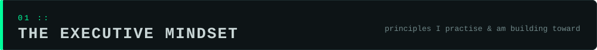

> **Honest framing:** these are leadership principles and capabilities I practise and am developing. They are not claims of executive tenure or a current CEO position.

<table>
<tr>
<td width="50%" valign="top">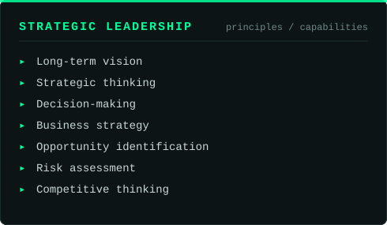</td>
<td width="50%" valign="top">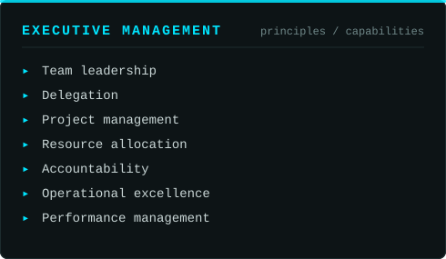</td>
</tr>
<tr>
<td width="50%" valign="top">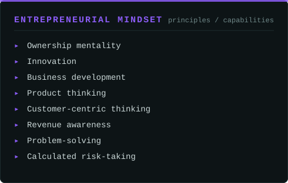</td>
<td width="50%" valign="top">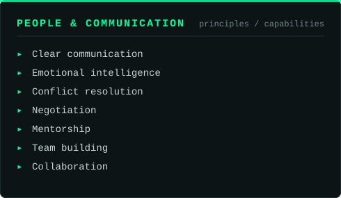</td>
</tr>
</table>

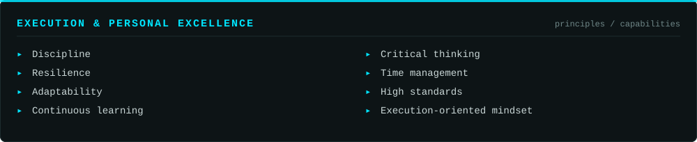

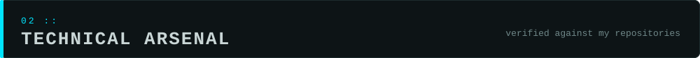

Levels are assigned from what is actually used in my repositories:
**● Experienced** (core to several projects) · **◐ Working knowledge** (used in real projects) · **○ Exploring** (learning, little or no production use yet).

| | ● Experienced | ◐ Working knowledge | ○ Exploring |
|:--|:--|:--|:--|
| **AI & Intelligent Systems** |   |     |  |
| **Backend Engineering** |  |       | |
| **Development & Infrastructure** | |       | |
| **AI Ecosystem** |  |      |  |
| **Also used** | |      | |

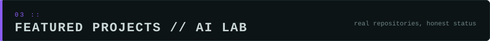

Project descriptions come from each repository's own code and documentation. Private repositories are shown without links.

<table>
<tr>
<td width="50%" valign="top"><a href="https://github.com/Abdullahzahoor755/LEAD-HUNTER">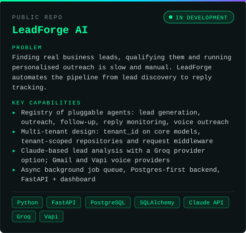</a></td>
<td width="50%" valign="top">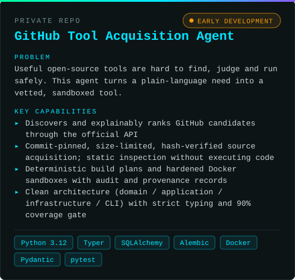</td>
</tr>
<tr>
<td width="50%" valign="top">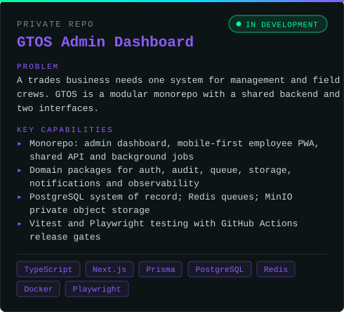</td>
<td width="50%" valign="top"><a href="https://github.com/Abdullahzahoor755/Agent-factory-book">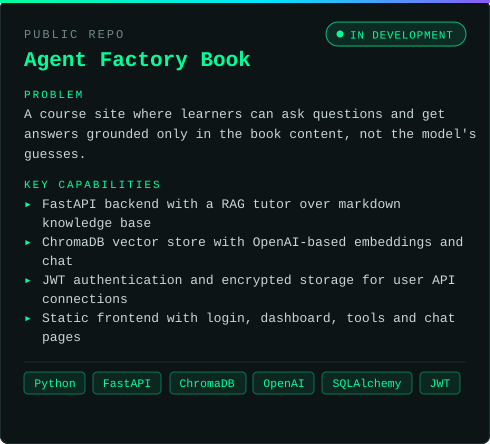</a></td>
</tr>
</table>

<a href="https://github.com/Abdullahzahoor755/AI-assistant">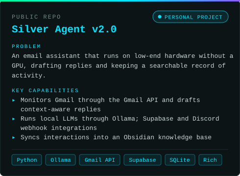</a>

More public work: [Voice_agent](https://github.com/Abdullahzahoor755/Voice_agent) · [call_center_agent](https://github.com/Abdullahzahoor755/call_center_agent) · [Skeleton-3d-camera](https://github.com/Abdullahzahoor755/Skeleton-3d-camera) · [about-me](https://github.com/Abdullahzahoor755/about-me)

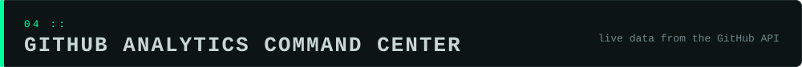

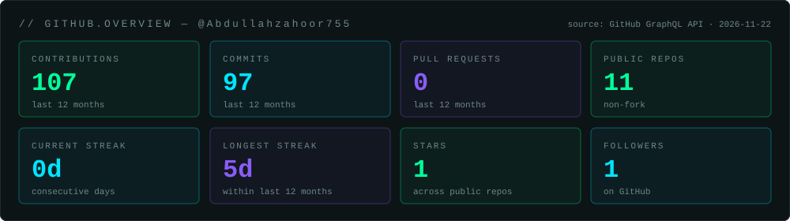

<table>
<tr>
<td width="50%" valign="top">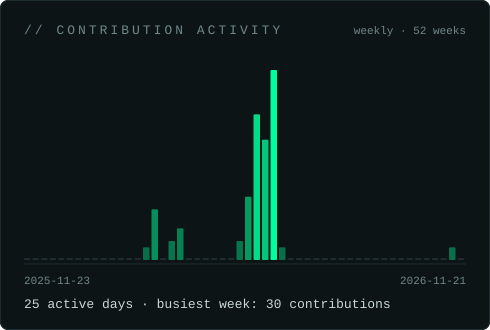</td>
<td width="50%" valign="top">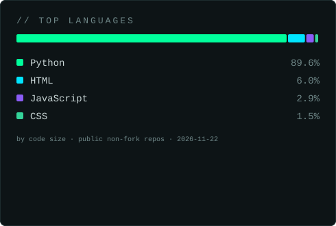</td>
</tr>
</table>

Generated from the GitHub GraphQL API by [`scripts/generate_stats.py`](scripts/generate_stats.py) and refreshed daily by a GitHub Action. Public data only.

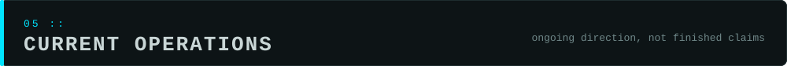
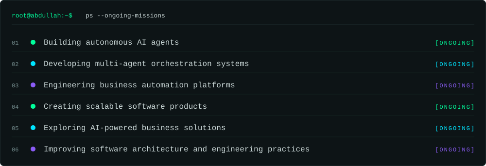

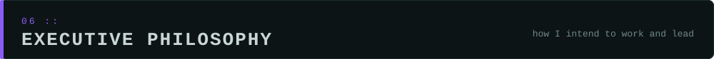
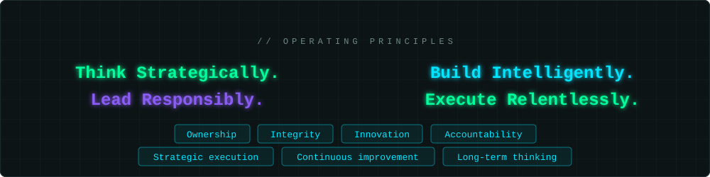

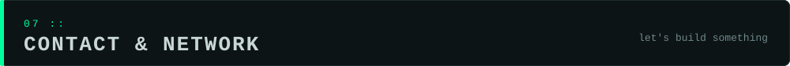

 

 

Based in Lahore, Pakistan · Profile views: 

<code>root@abdullah:~$ echo "Think Strategically. Build Intelligently. Lead Responsibly. Execute Relentlessly."</code>

